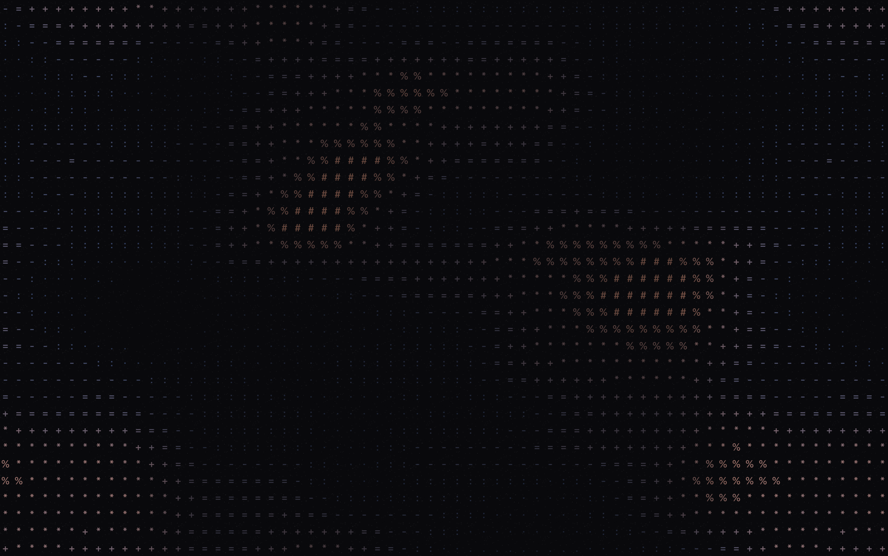

# Tipos

A backdrop theme for the Claude Code desktop app: a field of characters `.·:-=+*%#` in Geist that drifts slowly from left to right behind the conversation. Glyph weight comes from fbm noise plus a sine wave, shading from cool blue `#78A0F5` to warm peach `#F5A587` on near-black, with a light film grain. Glyphs behind the conversation column are dimmed.



## Install

```bash
claude plugin marketplace add publi0/claude-tema-tipos
claude plugin install tipos@tipos-local --scope user
```

New sessions pick it up automatically. In an open session, run `/reload-plugins`.

## Use

- `/tipos dark` (default), `/tipos light` (graphite on cream), `/tipos auto`.
- The field pauses after 3 minutes without activity and respects the system's reduce-motion setting.

## Files

- `hooks/register.tsx`: theme colors, the `/tipos` command and timing.
- `hooks/field.ts`: the field, generated as SVG.
- `hooks/glyph-shapes.ts`: Geist outlines for the 9 glyphs, generated by `tools/make-glyph-shapes.py`.
- `hooks/make-colors.js`: Claude Code's palette generator.

To check: `claude plugin validate .` and `tsc -p .`.

## License

Glyph outlines come from [Geist](https://github.com/vercel/geist-font) (SIL Open Font License, see `GEIST-LICENSE.txt`).
